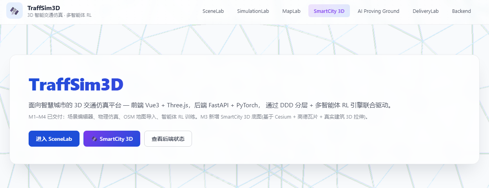
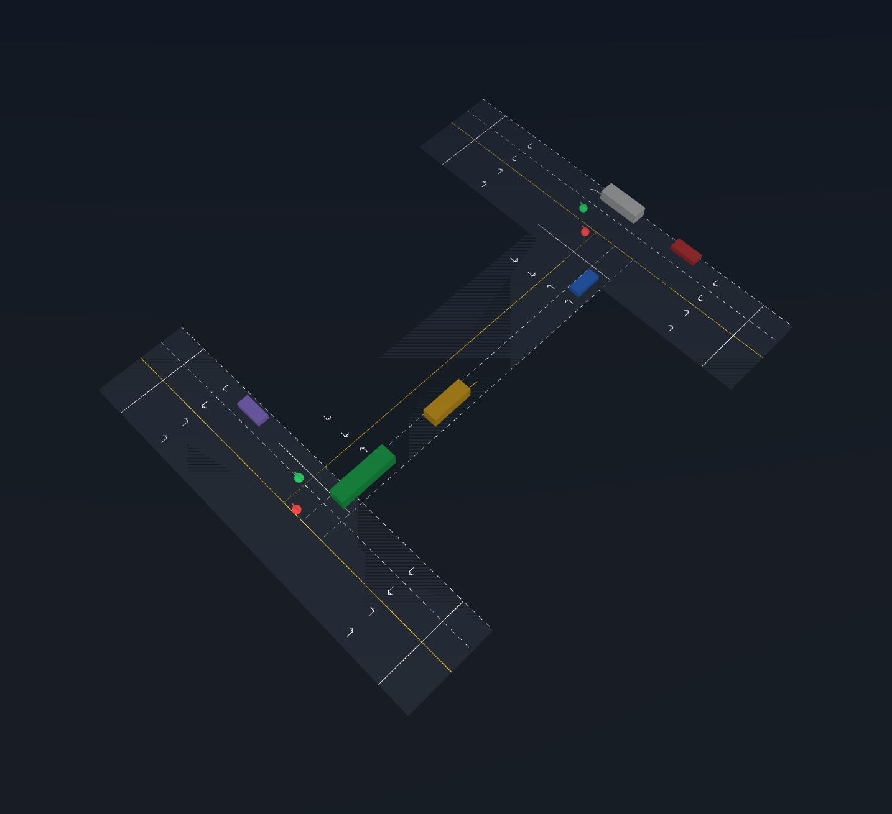
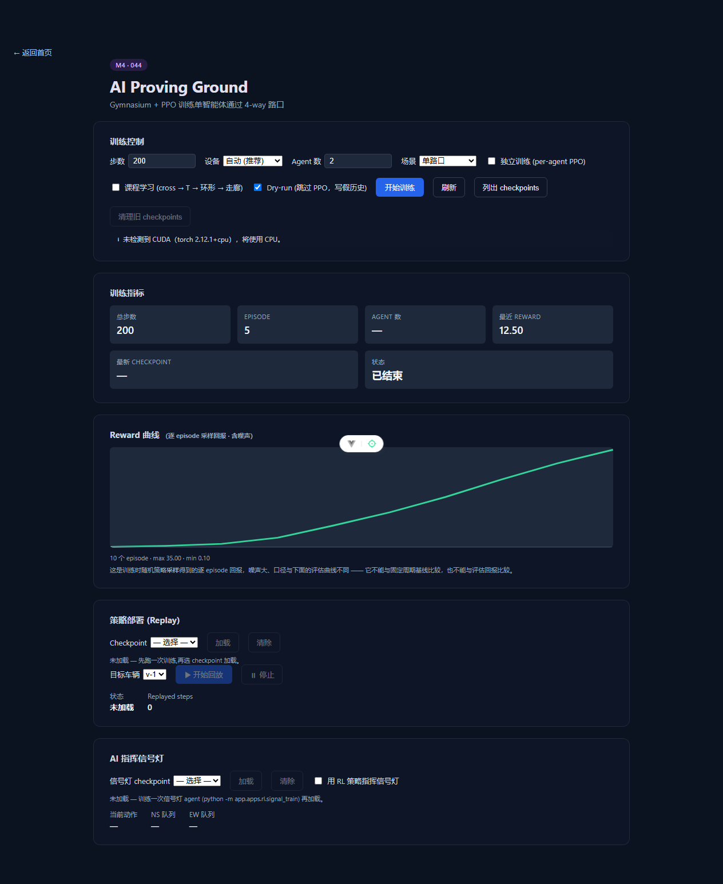

# TraffSim3D

**面向智慧城市的 3D 智能交通仿真平台。** 前端用 Vue 3 + Three.js 做可视化与物理仿真，后端用 Python FastAPI + PyTorch 跑强化学习引擎 —— 让多智能体 RL 在一座虚拟城市里同时学会**开车**和**调度信号灯**。

[](https://github.com/Echovagant/TraffSim3D/actions/workflows/ci.yml)
[](LICENSE)



---

## 目录

- [它能做什么](#它能做什么)
- [界面预览](#界面预览)
- [快速开始](#快速开始)
- [技术栈](#技术栈)
- [架构](#架构)
- [文档](#文档)
- [许可](#许可)

---

## 它能做什么

### 🛣️ SceneLab · 场景编辑器

在浏览器里搭路网：双向车道、停止线、信号灯、生成点。拖拽摆放车辆与设施，实时看到它们在路网上跑起来。场景可存本地、可导出成 JSON、可再导入。

### ⚙️ SimulationLab · 仿真实验室

基于 **Rapier WASM** 的刚体物理，车辆有质量、转向半径、制动距离和轮胎侧滑。固定步长推进，仿真结果不随机器性能漂移。

四套信号控制策略可以随时切换：

| 策略 | 行为 |
|---|---|
| 固定周期 | 30s 绿 + 3s 黄 + 30s 红，循环 |
| 感应控制 | 有排队就延长绿灯，对向空了就缩短红灯 |
| 协调控制 | 相邻路口组成绿波带，车队连续过路口 |
| RL 控制 | 由训练好的策略网络实时决定配时 |

挂载 **LiDAR 点云**与**相机**传感器，把感知数据导出成点云/轨迹文件。

### 🧠 AI Proving Ground · 智能体演武场

**Gymnasium + PPO** 训练两类智能体：

- **ego 驾驶员** —— 纯追踪转向 + 车道保持，面对红灯要停、面对弯道要减速、到了路口要过；
- **信号灯 agent** —— 直接输出配时动作（延长当前绿灯 / 缩短红灯 / 切换轴 / 延长绿灯到指定秒数），在总延误和冲突之间做取舍。

训练面板提供多种子择优、reward 曲线、checkpoint 管理、课程学习开关，以及**把 checkpoint 回放进浏览器**的策略回放。

### 🗺️ MapLab · 地图导入

导入真实的 **OpenStreetMap** 路网（`.osm` XML 与 `.osm.pbf` 二进制都支持），可按 bbox 裁剪、按路网连通性做 **A\* 寻路**，并自动生成场景。

### 🌆 SmartCity 3D

**Cesium** 渲染真实城市底图（瓦片 + OSM 3D 拉伸建筑 + 道路多段线），把仿真叠加上去。

### 🔗 跨语言契约

仿真核心在 **Python（训练用）** 和 **TypeScript（浏览器用）** 各实现了一份。两份实现对同一条轨迹必须给出**相同**的结果 —— 18 组契约向量在 CI 里逐帧比对（其中 13 组要求**逐字节相等**，5 组转向向量按 1e-9 的浮点噪声地板判定），Python 侧和浏览器侧任何一边改坏了，CI 立刻变红。

契约的覆盖范围与**盲区**都写在 [`docs/contracts/sim-snapshot.md`](docs/contracts/sim-snapshot.md) 里 —— 包括浏览器那条 Rapier 物理路径**不在**向量覆盖内、而是由什么机制钉住的。

---

## 界面预览

### 场景编辑器



### 智能体演武场



### 演示视频

仓库内附一段完整演示：[`docs/media/traffsim3d-demo.webm`](docs/media/traffsim3d-demo.webm)

---

## 快速开始

需要 **Python 3.12+** 与 **Node 20.19+ / 22.12+**。

### 后端

```bash
cd TraffSim3D-backend
python -m venv .venv
.\.venv\Scripts\python.exe -m pip install -e ".[dev]"

# 启动（开发模式，热重载）
.\.venv\Scripts\python.exe -m uvicorn app.main:app --reload --port 8000
```

冒烟检查：

```bash
curl http://localhost:8000/health          # {"status":"ok"}
curl http://localhost:8000/api/v1/ping     # {"pong":true}
```

### 前端

```bash
cd TraffSim3D-frontend
npm install
npm run dev            # http://localhost:5173/
```

首页 `/` 是总览，主要路由：

| 路由 | 模块 |
|---|---|
| `/scene-editor` | 场景编辑器 |
| `/simulation-lab` | 仿真实验室 |
| `/ai-playground` | 智能体演武场 |
| `/map-importer` | 地图导入 |
| `/smart-city` | 城市 3D 底图 |
| `/backend` | 后端状态自检 |

### 跑测试

```bash
# 前端单元测试
cd TraffSim3D-frontend && npm run test:run

# 后端单元测试
cd TraffSim3D-backend && .\.venv\Scripts\python.exe -m pytest

# 端到端测试（需要先装浏览器）
cd TraffSim3D-frontend && npx playwright install chromium && npm run test:e2e

# 跨语言契约自检
cd TraffSim3D-frontend && npm run contract:check
```

---

## 技术栈

**前端**

| | |
|---|---|
| 框架 | Vue 3.5 · Vite 7 · TypeScript 5.6 · Pinia 3 · Vue Router 4 |
| 3D | Three.js 0.180 · postprocessing 6.37 · GSAP 3.15 · Cesium 1.134 |
| 物理 | Rapier 0.14（WASM） |
| 测试 | Vitest 2 · Playwright 1.61 |

**后端**

| | |
|---|---|
| 服务 | FastAPI · Uvicorn · Pydantic |
| 强化学习 | Gymnasium · Stable-Baselines3 2.9 · PyTorch 2.11（CUDA 可用） |
| 地理数据 | osmium（OSM XML / PBF 解析） |

---

## 架构

### 前端：DDD 四层

```
src/
├── domain/          实体与值对象（Vehicle / Road / Phase / Position …）
├── application/     用例与领域服务（tick 仿真循环、信号控制、传感器、生成、持久化）
├── infrastructure/  渲染（Three.js）· 物理（Rapier）· 传感器 · RL 推理 · 地图 · API
├── interfaces/      视图、组件、composables、Pinia store
└── shared/          公共类型与常量
```

`domain/` 是纯的：不依赖 Three.js，不依赖 DOM，可以直接被后端的 Gymnasium 环境消费。

### 后端：按能力分应用

```
app/
├── apps/rl/          Gymnasium 环境、PPO 训练、课程学习、checkpoint、权重导出
├── apps/maps/        OSM 解析、路网图、Overpass 缓存
├── apps/simulation/  仿真服务
├── apps/perception/  感知服务
├── models/  core/  storage/  api/v1/
```

### 仿真契约

`docs/contracts/sim-snapshot.md` 是 Python 与 TypeScript 两侧的行为契约：观测量布局、动作语义、道路规则、场景清单、以及哪些内容**不在**契约覆盖范围内（盲区表）。

---

## 文档

| 文档 | 内容 |
|---|---|
| [`docs/USER-GUIDE.md`](docs/USER-GUIDE.md) | 面向使用者：每个模块怎么用 |
| [`docs/ARCHITECTURE.md`](docs/ARCHITECTURE.md) | 系统结构：每个断言都给出代码出处 |
| [`docs/DEPLOYMENT.md`](docs/DEPLOYMENT.md) | 部署与运行（含镜像源与依赖安装） |
| [`docs/contracts/sim-snapshot.md`](docs/contracts/sim-snapshot.md) | 跨语言仿真契约 |
| [`docs/adr/`](docs/adr/) | 架构决策记录（ADR-001 ~ ADR-009） |
| [`docs/openapi.json`](docs/openapi.json) | 后端 API 定义 |

---

## 许可

[Apache License 2.0](LICENSE) © 2026 Echovagant
