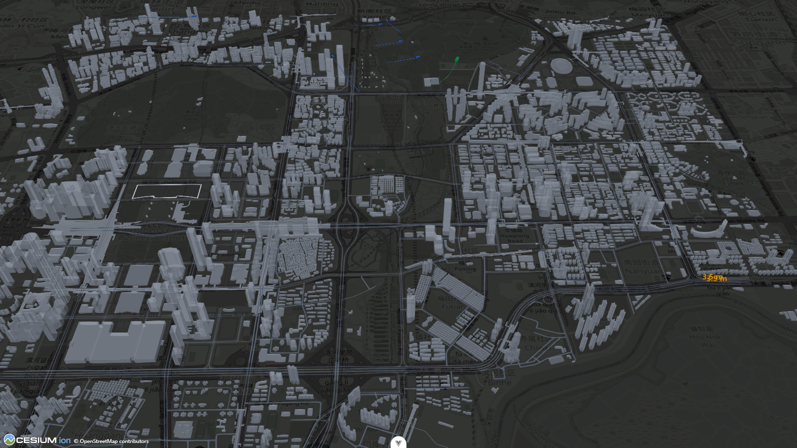
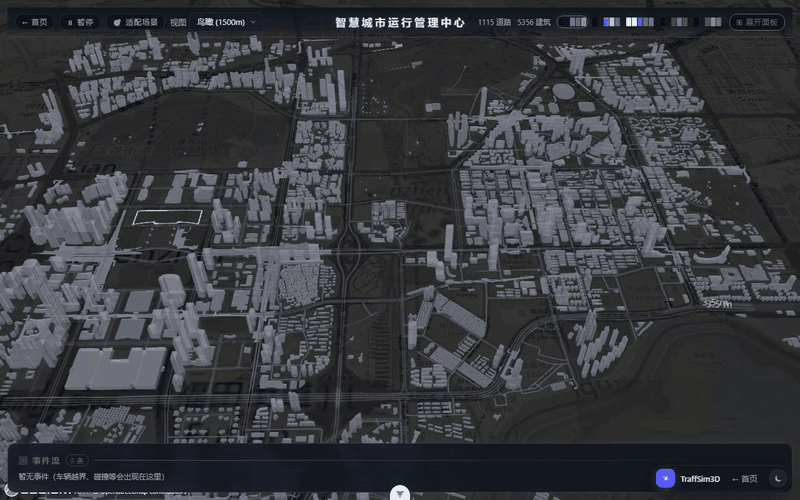
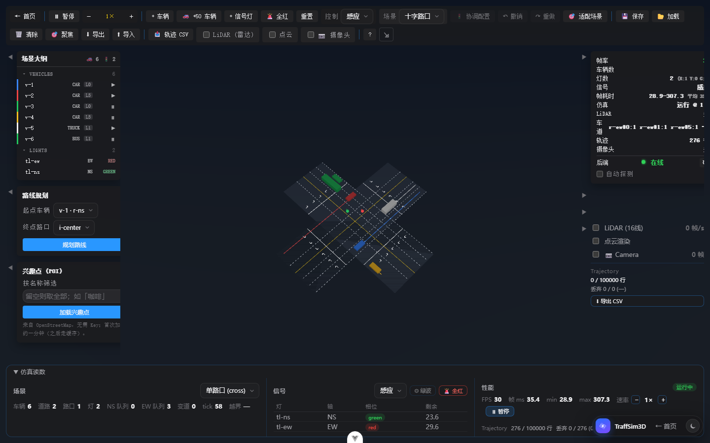
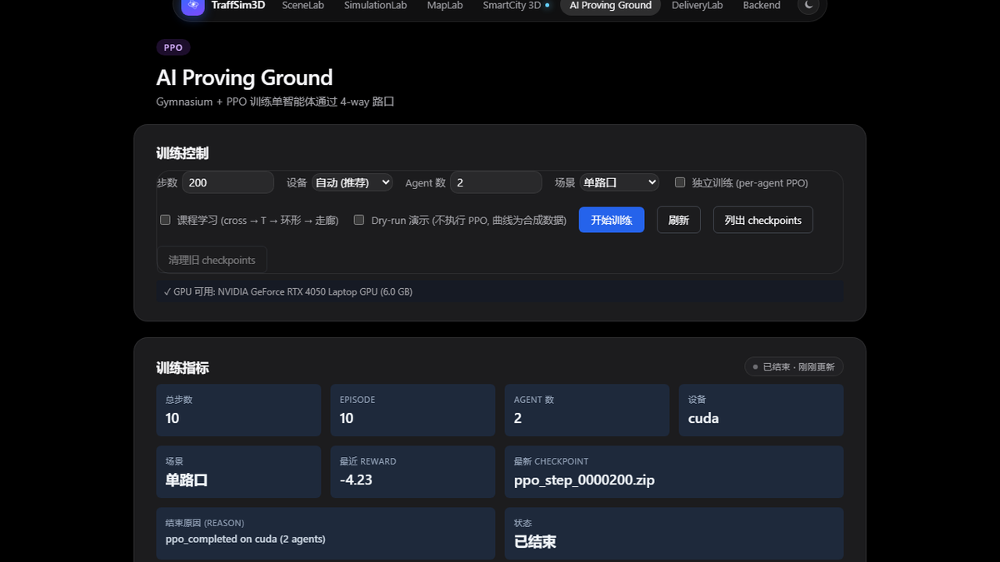
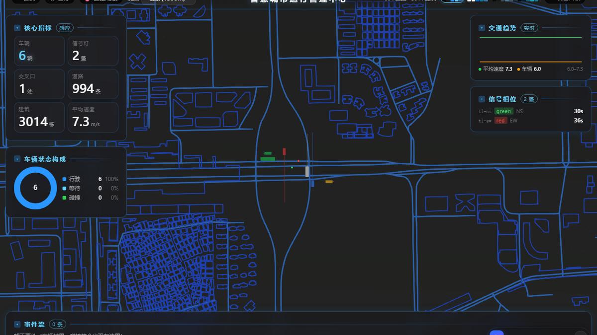
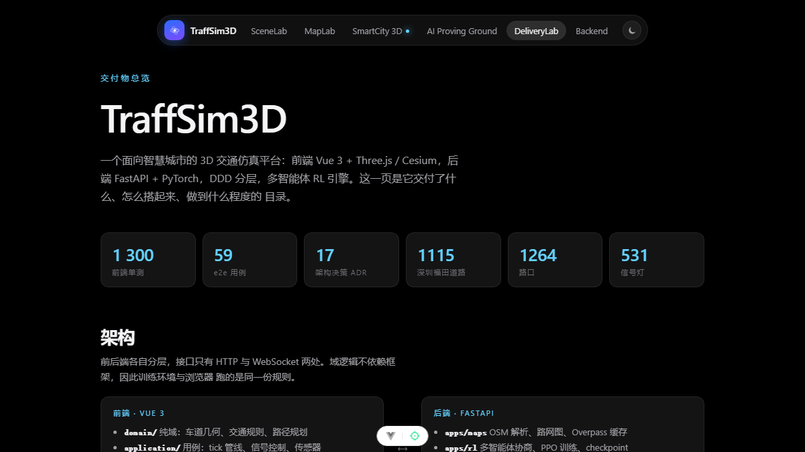

# TraffSim3D

**面向智慧城市的 3D 交通仿真平台。** 前端 Vue 3 + Three.js 做可视化与刚体物理仿真，后端 Python FastAPI + PyTorch 跑强化学习引擎 —— 让多智能体 RL 在路网里同时学习**开车**与**调度信号灯**。

[](https://github.com/Echovagant/TraffSim3D/actions/workflows/ci.yml)
[](LICENSE)



---

## 演示



4 秒循环：车在白模城区里跑，前方是随包路网的限高门架 —— 公交（3.4 m）过不去，小车过得去。录屏原片 `docs/media/traffsim3d-demo.webm`。

---

## 它能做什么

### SceneLab · 场景编辑器

在浏览器里搭路网：车道、停止线、信号灯、生成点。拖拽摆放车辆，实时看到它们在路网上跑起来。场景可存本地、可导出成 JSON、可再导入。

选一辆车和一个终点路口，后端按路网算最省路径（单行道只能顺行），路线画在车实际行驶的车道上 —— 切到第一人称视角，你就坐在车里。

**兴趣点（POI）**：把地图上的咖啡店、医院、加油站叠到路网上 —— 数据来自 OpenStreetMap，**无需申请任何地图服务的 Key**。选一个兴趣点作为目的地，车会规划路线开过去。

页面底部自带**仿真读数抽屉**：场景统计、四套信号控制策略随时切换、帧率、越界处理原因。

### AI Proving Ground · 智能体演武场

**Gymnasium + PPO** 训练两类智能体：

- **ego 驾驶员** —— 纯追踪转向 + 车道保持，红灯要停、弯道要减速；
- **信号灯 agent** —— 输出配时动作（延长绿 / 缩短红 / 切换轴），在总延误与冲突之间取舍。

训练面板提供多种子择优、reward 曲线、checkpoint 管理，以及**把 checkpoint 回放进浏览器**的策略回放。

> 目前是**雏形**：训练跑得通，策略只在简单场景（单路口、2×2 网格）上验证过，规模与效果都还远。

### MapLab · 地图导入

导入 **OpenStreetMap** 路网（`.osm` XML 与 `.osm.pbf` 二进制都支持），可按 bbox 裁剪、按路网连通性做 **A\* 寻路**，并自动生成场景。

国内地图服务导出的文件（高德 GCJ-02、百度 BD-09）在解析入口**自动转到 WGS84**，选对坐标系即可。

### SmartCity 3D

**Cesium** 渲染城市底图（OSM 瓦片 + OSM 3D 拉伸建筑），把仿真叠上去。底图与路网数据**同源同基准**（都是 WGS84），叠上去的路线与底图上的街道是重合的。

**路权也来自 OSM 数据**：车太宽的巷子画成暗色、路口拉起限行杆；隧道口的 `maxheight`（随包城区的春风隧道是 3.5 m）**按数据生效** —— 小车过得去，公交与货车上不去，门架上标着那个数字。

### 仿真内核

基于 **Rapier WASM** 的刚体物理，车辆有质量、转向半径、制动距离和轮胎侧滑。固定步长推进，仿真结果不随机器性能漂移。路面的高程是真的 —— 车沿着坡道开上去，车身随路面俯仰。

四套信号控制策略可以随时切换：

| 策略     | 行为                                 |
| -------- | ------------------------------------ |
| 固定周期 | 30s 绿 + 3s 黄 + 30s 红，循环        |
| 感应控制 | 有排队就延长绿灯，对向空了就缩短红灯 |
| 协调控制 | 相邻路口组成绿波带                   |
| RL 控制  | 由训练好的策略网络决定配时           |

挂载 **LiDAR 点云**与**相机**传感器，把感知数据导出成点云 / 轨迹文件。

### 跨语言契约

仿真核心在 **Python（训练用）** 和 **TypeScript（浏览器用）** 各实现了一份。两份实现对同一条轨迹必须给出**相同**的结果 —— 18 组契约向量在 CI 里逐帧比对（13 组要求**逐字节相等**，5 组转向向量按 1e-9 的浮点噪声地板判定），任何一边改坏了 CI 立刻变红。

覆盖范围与**盲区**写在 [`docs/contracts/sim-snapshot.md`](docs/contracts/sim-snapshot.md)。

---

## 界面预览

### 场景编辑器



### 智能体演武场



### 城市 3D



### 交付总览



---

## 技术栈

**前端**

|      |                                                                 |
| ---- | --------------------------------------------------------------- |
| 框架 | Vue 3.5 · Vite 7 · TypeScript 5.6 · Pinia 3 · Vue Router 4      |
| 3D   | Three.js 0.180 · postprocessing 6.37 · GSAP 3.15 · Cesium 1.134 |
| 物理 | Rapier 0.14（WASM）                                             |
| 测试 | Vitest 2 · Playwright 1.61                                      |

**后端**

|          |                                                          |
| -------- | -------------------------------------------------------- |
| 服务     | FastAPI · Uvicorn · Pydantic                             |
| 强化学习 | Gymnasium · Stable-Baselines3 2.x · PyTorch（CUDA 可用） |
| 地理数据 | osmium（OSM XML / PBF 解析）                             |

---

## 快速开始

需要 **Python 3.12+** 与 **Node 20.19+ / 22.12+**。

### 后端

```bash
cd TraffSim3D-backend
python -m venv .venv
.\.venv\Scripts\python.exe -m pip install -e ".[dev,rl]"

.\.venv\Scripts\python.exe -m uvicorn app.main:app --reload --port 8000
```

`rl` extra 装 Stable-Baselines3 与 PyTorch —— 演武场的训练与回放依赖它们；只跑场景编辑与地图导入时装 `.[dev]` 就够。

```bash
curl http://localhost:8000/health          # {"status":"ok"}
curl http://localhost:8000/api/v1/ping     # {"pong":true}
```

### 前端

```bash
cd TraffSim3D-frontend
npm install
npm run dev            # http://localhost:5173/
```

| 路由              | 模块                  |
| ----------------- | --------------------- |
| `/scene-editor`   | 场景编辑器 + 仿真读数 |
| `/ai-playground`  | 智能体演武场          |
| `/map-importer`   | 地图导入              |
| `/smart-city`     | 城市 3D 底图          |
| `/deliverables`   | 交付总览              |
| `/backend`        | 后端状态自检          |

### 跑测试

```bash
cd TraffSim3D-frontend && npm run test:run                    # 1308
cd TraffSim3D-backend && .\.venv\Scripts\python.exe -m pytest # 958
cd TraffSim3D-frontend && npx playwright install chromium && npm run test:e2e  # 59
cd TraffSim3D-frontend && npm run contract:check              # 跨语言契约
```

---

## 架构

### 前端：DDD 四层

```
src/
├── domain/          实体与值对象（Vehicle / Road / Phase / Position …）
├── application/     用例与领域服务（tick 仿真循环、信号控制、传感器、生成、持久化）
├── infrastructure/  渲染（Three.js）· 物理（Rapier）· 传感器 · RL 推理 · 地图 · API
├── interfaces/      视图、组件、composables、Pinia store
└── shared/          公共类型与常量
```

`domain/` 是纯的：不依赖 Three.js，不依赖 DOM，可以直接被后端的 Gymnasium 环境消费。

### 后端：按能力分应用

```
app/
├── apps/rl/          Gymnasium 环境、PPO 训练、课程学习、checkpoint、权重导出
├── apps/maps/        OSM 解析、路网图、Overpass 缓存、坐标系转换
├── apps/simulation/  仿真服务
├── apps/perception/  感知服务
├── models/  core/  storage/  api/v1/
```

### 仿真契约

`docs/contracts/sim-snapshot.md` 是 Python 与 TypeScript 两侧的行为契约：观测量布局、动作语义、道路规则、场景清单，以及哪些内容**不在**契约覆盖范围内（盲区表）。

---

## 文档

| 文档                                                               | 内容                              |
| ------------------------------------------------------------------ | --------------------------------- |
| [`docs/USER-GUIDE.md`](docs/USER-GUIDE.md)                         | 面向使用者：每个模块怎么用        |
| [`docs/ARCHITECTURE.md`](docs/ARCHITECTURE.md)                     | 系统结构：每个断言都给出代码出处  |
| [`docs/DEPLOYMENT.md`](docs/DEPLOYMENT.md)                         | 部署与运行（含镜像源与依赖安装）  |
| [`docs/contracts/sim-snapshot.md`](docs/contracts/sim-snapshot.md) | 跨语言仿真契约                    |
| [`docs/adr/`](docs/adr/)                                           | 架构决策记录（ADR-001 ~ ADR-017） |
| [`docs/openapi.json`](docs/openapi.json)                           | 后端 API 定义                     |

---

## 目录

- [演示](#演示)
- [它能做什么](#它能做什么)
- [界面预览](#界面预览)
- [技术栈](#技术栈)
- [快速开始](#快速开始)
- [架构](#架构)
- [文档](#文档)
- [许可](#许可)

---

## 许可

[Apache License 2.0](LICENSE) © 2026 Echovagant

**代码**为 Apache-2.0。**地理数据**来自 [OpenStreetMap](https://www.openstreetmap.org/copyright)，
依 [ODbL](https://opendatacommons.org/licenses/odbl/) 授权；仓库内附的
`TraffSim3D-backend/geojson/福田中心(深圳).osm` 切片与运行时缓存的 Overpass 响应均属该授权范围。
© OpenStreetMap contributors。底图瓦片与建筑同样来自 OSM，因此演示环境需要一次外网请求取瓦片；
**路网切片随包，仿真本身不依赖网络**。
