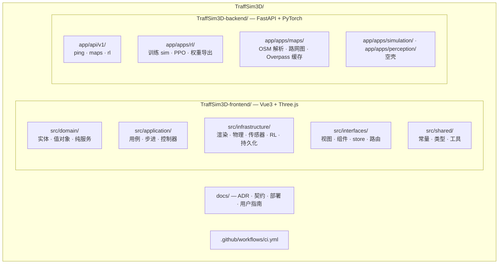
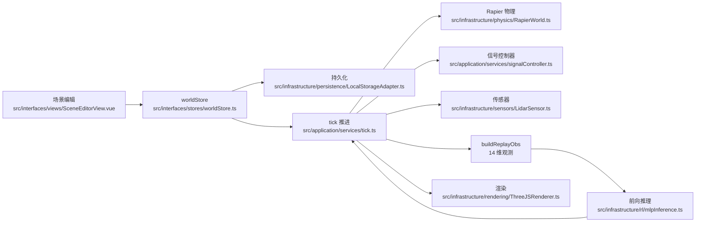
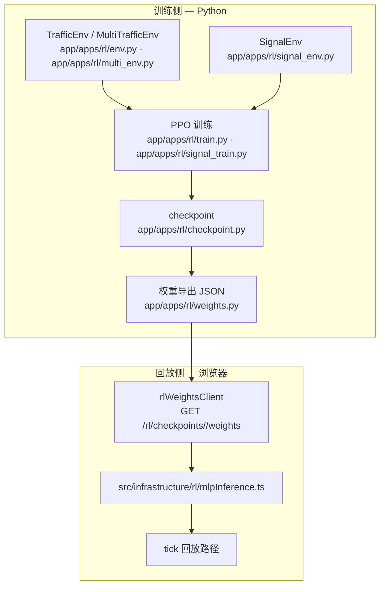

# TraffSim3D 架构文档

面向「要读懂这个系统、或者要接手它继续做」的人。

本文只描述**系统现在的样子**。每个结构性断言后面都给出代码出处（路径 + 符号），
便于自行核对。决策裁定内容与契约的逐项覆盖面、盲区表，分别以
[adr/](adr/) 与 [contracts/sim-snapshot.md](contracts/sim-snapshot.md) 为准，本文只做链接与结论。

---

## 1. 这个系统是什么

TraffSim3D 是一个 3D 智能交通仿真平台：前端用 Vue 3 + Three.js 做可视化与物理，
后端用 Python FastAPI + PyTorch 跑强化学习引擎。目标是在一个虚拟城市里，
让**多智能体 RL** 学习开车（ego 驾驶员）与交通控制（信号灯 agent）这两类策略。

- 前端技术栈（[TraffSim3D-frontend/package.json](../TraffSim3D-frontend/package.json)）：
  Vue 3.5、Vite 7、Three 0.180、Pinia 3、Vue Router 4、
  `@dimforge/rapier3d-compat` 0.14（Rapier WASM 物理）、Cesium 1.134、GSAP 3.15。
- 后端技术栈（[TraffSim3D-backend/pyproject.toml](../TraffSim3D-backend/pyproject.toml)）：
  FastAPI、Gymnasium、numpy、osmium（OSM PBF 解析）、pbf；RL 栈
  `stable-baselines3` 在 `[project.optional-dependencies].rl` 里，是**可选依赖**。
- 两个半独立的前后端仓库并列（不是嵌套），用
  [TraffSim3D.code-workspace](../TraffSim3D.code-workspace) 一起打开。

---

## 2. 仓库地图

| 目录 | 装什么 |
|---|---|
| `TraffSim3D-frontend/` | Vue3 + Three.js 前端。DDD 四层 + `shared/`，见第 3 节。 |
| `TraffSim3D-backend/` | Python FastAPI + SB3 后端。app-per-capability，见第 4 节。 |
| `docs/` | 权威文档：`adr/`（9 篇 ADR）、`contracts/sim-snapshot.md`（跨语言契约）、`DEPLOYMENT.md`、`USER-GUIDE.md`、`ARCHITECTURE.md`（本文）。 |
| `.github/workflows/ci.yml` | 四个 CI job：`backend` / `frontend` / `contract` / `e2e`。 |
| `e2e-output/baseline/` | Playwright 视觉回归基线 PNG（在**仓库根**，不在 frontend 子目录）。 |
| `TraffSim3D-backend/.data/` | RL 运行时产物（checkpoint / 训练状态 / 控制文件），gitignored。 |



### 从哪读起（5 步）

1. `docs/adr/ADR-005-architecture-ddd-split.md` —— 前后端切分与 DDD 分层的决策依据。
2. `TraffSim3D-backend/app/apps/rl/sim_core.py` —— 训练侧的仿真内核，**观测维度的权威定义**在
   该文件的 `OBS_DIM = 14`。这是整个系统里最该先读懂的一个文件。
3. `TraffSim3D-frontend/src/domain/services/egoKernel.ts` —— 与上者一一对应的 ego 运动学内核
   （TS 侧）。它被**契约镜像**和**产品回放路径**共用。
4. `docs/contracts/sim-snapshot.md` —— 两个内核如何被钉在一起，以及钉住了什么、没钉住什么。
5. `TraffSim3D-frontend/src/application/services/tick.ts` —— 浏览器侧每帧的推进逻辑。

---

## 3. 前端分层

`TraffSim3D-frontend/src/` 下是四个 DDD 层 + 一个共享层。依赖方向由内向外：
`domain` 不依赖任何框架，`interfaces` 依赖 `application` 与 `infrastructure`。
路径别名在 `vite.config.js` 与 `vitest.config.ts` 里各定义一遍：
`@domain` / `@application` / `@infrastructure` / `@interfaces` / `@shared`（外加 `@/` 指向 `src/`）。

| 层 | 装什么 | 关键文件 |
|---|---|---|
| `src/domain/` | 实体（`Vehicle` / `TrafficLight` / `Road` / `Lane` / `Intersection` / `RoadNetwork` / `SpawnPoint`）、值对象（`Position` / `Speed` / `Phase` / `LaneId`）、纯函数服务 | `src/domain/entities/`、`src/domain/value-objects/`、`src/domain/services/vehicleDynamics.ts`、`src/domain/services/purePursuit.ts`、`src/domain/services/egoKernel.ts`、`src/domain/services/laneGeometry.ts`、`src/domain/services/laneChange.ts`、`src/domain/services/networkBounds.ts` |
| `src/application/` | 用例与每帧推进逻辑：场景步进、信号控制、传感器登记、生成/清理车辆、存档读写 | `src/application/services/tick.ts`、`src/application/services/fixedStepScheduler.ts`、`src/application/services/signalController.ts`、`src/application/services/controllers/`、`src/application/services/sensors/SensorRegistry.ts`、`src/application/use-cases/`（`saveScene` / `loadScene` / `clearScene` / `importSceneFile` / `exportSceneFile`） |
| `src/infrastructure/` | 所有技术实现：渲染、物理、传感器、RL 推理、持久化、导出、后端 API 客户端、Cesium | `src/infrastructure/rendering/ThreeJSRenderer.ts`、`src/infrastructure/physics/RapierWorld.ts`、`src/infrastructure/sensors/LidarSensor.ts`、`src/infrastructure/sensors/CameraSensor.ts`、`src/infrastructure/rl/mlpInference.ts`、`src/infrastructure/persistence/LocalStorageAdapter.ts`、`src/infrastructure/persistence/sceneSerializer.ts`、`src/infrastructure/api/backendService.ts`、`src/infrastructure/api/rlWeightsClient.ts`、`src/infrastructure/api/osmImportClient.ts`、`src/infrastructure/export/TrajectoryExporter.ts`、`src/infrastructure/cesium/loadCesiumRuntime.ts` |
| `src/interfaces/` | 面向用户的部分：视图、组件、Pinia store、composable、路由 | `src/interfaces/views/`（8 条路由 + 404 兜底页）、`src/interfaces/components/`、`src/interfaces/stores/worldStore.ts`、`src/interfaces/stores/selectionStore.ts`、`src/interfaces/composables/useWorldSimulation.ts`、`src/interfaces/router/index.js` |
| `src/shared/` | 跨层共享的常量、类型、工具 | `src/shared/constants/simulation.ts` |

### 几条硬约束

- **`domain/` 里没有 Three.js、DOM、Rapier。** 实体与值对象是可序列化的纯数据，
  这样后端的 Gymnasium env 才能直接消费同一套语义。`egoKernel.ts` 的文件头注释把这条
  写成了显式约束（`Pure functions only: no DOM, no Three.js, no Rapier`）。
- **仿真内核只有一份 TS 实现**：`src/domain/services/egoKernel.ts`。
  契约镜像（`src/application/services/simCoreMirror.ts`）与产品回放路径
  （`src/application/services/tick.ts`）都用它，
  所以镜像与产品在 ego 模型上不可能分叉。
- **信号动作词表在两侧各有一份拷贝**，故意不共用同一个文件：
  TS 在 `src/shared/constants/simulation.ts` 的 `SIGNAL_ACTION_NAMES`，
  Python 在 `app/apps/rl/sim_core.py` 的 `SIGNAL_ACTION_NAMES`。
  共用文件会让「两侧一致」这个断言变成空话，所以契约改为逐项比对这两份拷贝。

### 路由（`src/interfaces/router/index.js`）

`/`（首页）、`/scene-editor`、`/simulation-lab`、`/ai-playground`、
`/map-importer`、`/smart-city`、`/deliverables`、`/backend`，外加 404 兜底。

---

## 4. 后端分层

`TraffSim3D-backend/app/` 是 app-per-capability 的形状：

| 位置 | 状态 |
|---|---|
| `app/main.py` | FastAPI 入口。`GET /health`；CORS 白名单覆盖 5173 / 4173 / 5188（`localhost` 与 `127.0.0.1` 各一份）。 |
| `app/api/v1/ping.py` | `GET /api/v1/ping` → `{"pong": true}`。 |
| `app/api/v1/maps.py` | `POST /maps/parse-osm`、`POST /maps/parse-pbf`、`GET /maps/overpass`、`GET /maps/overpass/cache`。两个解析端点接受可选的 `bbox` 裁剪参数（顺序 `south, west, north, east`），两个 Overpass 端点不接受。 |
| `app/api/v1/rl.py` | `POST /rl/train`、`GET /rl/status`、`GET /rl/capabilities`、`POST /rl/train/pause`、`POST /rl/train/resume`、`POST /rl/train/terminate`、`GET /rl/checkpoints`、`DELETE /rl/checkpoints`、`GET /rl/scenes`、`GET /rl/training-config`、`GET /rl/checkpoints/{name}/weights`。 |
| `app/apps/rl/` | **已实现**。训练 sim、两个 env、PPO 训练、checkpoint、权重导出、课程学习、信号灯训练、控制通道、运行时路径。文件清单见第 5、9 节。 |
| `app/apps/maps/` | **已实现**。`osm_parser.py`（OSM XML / PBF → 路网）、`road_graph.py`（有向图 + A\* 最短路）、`overpass_cache.py`（Overpass 响应落盘缓存）。 |
| `app/apps/simulation/` | **空壳**。`__init__.py` 的 docstring 写明「Not implemented」，并说明物理推进目前在客户端侧（前端 Rapier + `tick.ts`）跑，后端编排推迟到出现具体消费者为止。 |
| `app/apps/perception/` | **空壳**。`__init__.py` 一行注释说明 YOLO 检测与多目标跟踪是「optional, deferred」。 |
| `app/core/`、`app/models/`、`app/storage/` | **空壳**（只有 `__init__.py`）。存储栈（PostgreSQL/PostGIS、Redis、MinIO）尚未引入。 |

---

## 5. 两条数据流

### 5.1 浏览器侧：编辑 → 持久化 → 步进 → 传感器 → 推理 → 渲染



要点：

- **步进入口**：`tick(network, dt, simTime, ctx)`（`src/application/services/tick.ts`）。
  第五个参数 `ctx: TickContext` 打包了 `rapierWorld`、`signal`、`trajectoryExporter`、
  `sensorRegistry`、`lidarEnabled`、`getHostPose`。
- **信号冲突消解**：`tick.ts` 里的 `resolveSignalConflicts(inter)` 按交通法规
  **GB 14886** 的要求处理冲突方向的放行关系（同一冲突面上先到的相位保持，
  后到的强制转红）。
- **固定步长**：`src/application/services/fixedStepScheduler.ts` 的 `FixedStepScheduler`
  把可变间隔的墙钟 dt 转成固定速率的步进边界事件，默认 `fixedStepSec = 0.1`（10 Hz），
  `maxAccumulator = 0.5`（浏览器 GC 停顿或切标签页时钳住累积量，避免补跑几十步）。
  采样侧另有 `TRAJECTORY_SAMPLE_INTERVAL = 0.1` 与 `LIDAR_SCAN_INTERVAL_S = 0.1`。
- **观测构造**：`tick.ts` 的 `buildReplayObs(ego, network)` 产出 **14 维**观测，
  其中的观测维度常量在同文件里写作 `const OBS_DIM = 14`。
  归一化分母（位置 50 m、航向 π、速度 16.67 m/s、NPC 距离 50 m）必须与 Python 侧一致，
  否则 PPO 会吃到「比训练时更小」的速度而开得离谱。
- **推理**：`src/infrastructure/rl/mlpInference.ts` 用纯 TS 重实现 SB3 默认 MlpPolicy 的前向，
  分两条路径：`mlpForwardMean` / `mlpForwardSample`（连续动作，带 `log_std`）与
  `mlpForwardDiscrete`（离散动作，取 logits 的 argmax）。
- **物理**：Rapier WASM 由 `RapierWorld.init()` 惰性加载，懒加载独立 chunk，
  与首屏无关。`src/interfaces/composables/useWorldSimulation.ts` 里 Rapier 初始化失败时场景仍然渲染，只是物理不推进。

### 5.2 训练侧与回放链路



- **训练是子进程**：`POST /rl/train` 用 `subprocess.Popen` 拉起 `python -m app.apps.rl.train`，
  接口立刻返回 PID；进度与控制走文件，不走信号（见第 9 节）。
- **checkpoint**：`app/apps/rl/checkpoint.py` 按进程分子目录存放，
  `CHECKPOINT_KEEP = 5`；`GET /rl/checkpoints` 跨进程汇总，`DELETE /rl/checkpoints` 只保留最新 5 个。
- **权重导出**：`app/apps/rl/weights.py` 的 `export_weights()` 把 checkpoint 里的
  `state_dict()` 摊平成 JSON 可序列化的嵌套数组，并带上 `obs_dim` / `action_dim` /
  `hidden_sizes` 与 `action_space`（`"discrete"` 或 `"continuous"`）。
  离散策略没有 `log_std`（SB3 的 `CategoricalPolicy` 出的是 logits），连续策略才有；
  `action_space` 缺失时按连续处理。

### 5.3 两个 agent 的分工

| | ego 驾驶员 | 信号灯 agent |
|---|---|---|
| 环境 | `TrafficEnv`（`app/apps/rl/env.py`）、多环境版 `MultiTrafficEnv`（`app/apps/rl/multi_env.py`） | `SignalEnv`（`app/apps/rl/signal_env.py`） |
| 观测 | `Box(-1, 1, (14,))`，`OBS_DIM = 14` | `Box(-1, 1, (SIG_OBS_DIM,))`，`SIG_OBS_DIM = 6` |
| 动作 | `Box(-1, 1, (2,))` 连续 | `Discrete(len(SIGNAL_ACTION_NAMES))`，即 **5** 个动作 |
| 动作语义 | `action[0]` = 加速度（`clip(a, -1, 1) * 3.0`，m/s²）；`action[1]` = **转向残量**（`clip(a, -1, 1) * MAX_STEER`，叠加在 Pure Pursuit 的脚本转向之上） | 词表：`extend_green` / `shorten_red` / `preempt` / `force_all_red` / `no_op` |
| 浏览器侧对应 | `buildReplayObs` + `mlpInference` + `tick` 的回放分支 | `src/application/services/signalPolicySource.ts` 造 6 维观测 → `mlpForwardDiscrete` → `SignalActionSource` → `src/application/services/controllers/RLController.ts` |
| 场景 | `cross` / `corridor` / `t_junction` / `roundabout` / `cross_signalled` | 同左 |

- **ego 的观测维度 14 由 Python 侧定义**（`app/apps/rl/sim_core.py` 的 `OBS_DIM = 14`），
  与 [contracts/sim-snapshot.md](contracts/sim-snapshot.md) 一起构成契约；
  **前端对齐 Python，不反向**。
- **信号灯 agent 的 6 维观测**在 Python 侧是参考实现（`SignalEnv._obs()`），
  浏览器侧的 `signalPolicySource.ts` 重建同样的六个量。注意 idx 5 是**已过相位比例**
  （elapsed），不是剩余比例 —— 权重是按 Python 的定义训出来的，喂错量网络就吃到
  训练时没见过的输入。
- **信号 agent 的奖励**是总延误（两条轴的排队长度曲线下的负面积）。
  **最小绿灯时间**（`MIN_GREEN_SECS`）加在环境层（动作被 mask、灯不被改动），
  **不在** `sim_core` 的物理灯模型里 —— 后者是契约的敏感区，默认行为必须逐位不变。

### 5.4 交付面：随产品附带的网格策略

5×5 网格的 MAPPO 策略（seed 0 —— 三个训练种子里浏览器侧实测最优的那份）**随产品附带**。
资产 `app/apps/rl/assets/network_mappo_grid_policy.json` 由
`scripts/gen_network_mappo_fixture.py` 与前端的 forward-pass fixture
（`network-mappo-policy-fixture.json`）**同一次运行写出**，`tests/test_rl_grid_policy.py`
用「资产权重必须复现 fixture 的期望动作」把两者钉在一起 —— 两条引用不会悄悄漂移。

- `GET /api/v1/rl/signal/grid-policy` 返回这份权重：读 JSON 资产、全量校验（离散 /
  6 obs / 5 act / 64×64 隐层 / 无 `log_std` / 矩阵形状与元数据一致）后返回。
  **不依赖 SB3 / torch** —— 只装基础依赖的后端（如 e2e 的那个）也能服务它。
- AI Playground 挂载时默认加载它并把控制器切到 RL：打开页面，训出的策略就在指挥
  信号灯；到场景页选「5×5 网格」即可观看。这是默认值不是锁定 —— 勾选框仍可切回
  感应控制器，本地 checkpoint 仍可加载覆盖。
- 训出的策略**只有一份随产品附带**，因为**迁移不是必然的**（已知限制，数字如下）：

  | 训练种子 | 训练侧 margin（3 个留出 seed） | 浏览器总延误（基线 4626.8 veh·s） |
  |---|---|---|
  | seed 0（随产品附带） | +89.1 | 4394.7（**−5.0 %**） |
  | seed 1 | +109.6 | 4531.0（−2.1 %） |
  | seed 2 | +116.0 | 4809.0（**+3.9 %**） |

  三个种子在训练侧全部打败固定周期基线；迁到浏览器（90 s / 67 辆 / 真 Rapier）实测，
  两个迁移成功、一个反向 —— 反向的正是触发过多的那份（`shorten_red` 占 38.8 %，
  迁移成功的两份是 10–12 %）。选优窗口、rollout 长度这些训练参数的影响记录在
  `network_mappo.py` 与 `network_signal_env.py` 的注释里。

### 5.5 交付面：路线规划与第一人称相机

**产品故事**：规划一条路线 → 坐在车里把它开完。
**决策记录**：[ADR-010](adr/ADR-010-route-planning-and-the-first-person-camera.md)。

```
browser (RoutePanel)
  │ POST /api/v1/routes/plan  {network, start{road_id,direction}, end{junction_id}}
  ▼
app/api/v1/routes.py  →  app/apps/maps/road_graph.py（节点级有向图 · A*）
  │  legs: [{road_id, from, to, cost_m}]
  ▼
routePlanner.ts（纯逻辑）→ store.plannedRoute {roads[], points[], lengthM}
  │                              │
  │                              ├→ RouteMesh.ts：路线带画在**车行驶的车道**上
  │                              └→ roadTransition.ts：跟车按路线的下一条路转向
  ▼
ThreeJSRenderer：跟随时相机接管（眼高 1.35 m · 前视 14 m），跟车自身不绘制
```

三条要点：

- **起点带方向**：车不在路口上，它在一条路上、正朝那头去。起点是「这条路、
  这个方向的那一头」，路径从车**下一个到达的节点**开始算 ⇒ 返回的 leg
  序列从车所在的位置就是可开的。单行道只能顺行，每条 leg 说清驶入方向。
- **只有跟车按路线走**：`roadContinuation` 多一个参数，路线指定的下一条路
  **在该路口确实是候选**时才采用，否则回落到哈希概率规则。**其余车辆一字
  未动** ⇒ 浏览器的总延误基线（4626.8 veh·s）与 RL 迁移结论（−5.0 %）仍然
  有效 —— 这条由「NPC 转向分布零变化」守住。
- **路线带画在车道上，不是路中线**：leg 是路段级的（路口到路口），节点落在
  中线上，离车 5.25 m。keep-right 规则让偏移统一：无论往哪个方向开，车都在
  **行进方向右侧** `laneOffset(0, laneCount)` 处（实测车到路线带的横向距离
  **0.00 m**）。

**枢轴碰撞没有被这条路线修掉**：转向车横扫路口角的几何（实测最多 7.4 m）
不变，路线消除的是「转向与计划矛盾」这一类错误。真正的修法是弧线，属于模型
改动（见 [ADR-010](adr/ADR-010-route-planning-and-the-first-person-camera.md)
的 Decision 末段）。

---

## 6. 跨语言契约边界

这一节是整个仓库里最容易理解错的地方，所以单列。

### 6.1 为什么需要它

Python 的训练 sim（`app/apps/rl/sim_core.py`）与 TypeScript 侧是**同一套交通模型的两份独立实现**。
契约要保证的是：**在 Python 里训出来的 PPO 策略，在浏览器里表现一致**，
而且任何一侧的漂移由测试捕获，而不是等用户看到一次糟糕的驾驶才发现。

### 6.2 机制：影子 sim + 双 oracle + golden 快照 + 变异门禁

- **影子 sim（mirror）**：`src/application/services/simCoreMirror.ts` 是 Python sim 的
  1:1 TS 移植（同样的常量、同样的方程、同样的终止规则、同样的 reason 字符串）。
  它存在的原因是：产品侧的 TS sim 是**车道制 + Rapier 驱动**的沙盒，
  与 Python 的自由空间模型结构上不兼容（跨语言差异 #6），
  直接比产品 sim 的完整轨迹没有意义。mirror 的 ego 运动学不重写，
  直接用 `src/domain/services/egoKernel.ts`，因此 mirror 与产品不可能在 ego 模型上分叉。
- **golden 快照**：`TraffSim3D-backend/tests/contract/snapshots/` 下有
  `ts_<name>.json`（场景级：终止原因、轨迹、灯态、词表块、`road_rules` 块、`scene_light` 块）、
  `ts_kernel_<name>.json`（内核级：ego 速度序列），
  以及每次运行重新生成、**gitignored** 的 `python_<name>.json`。
- **双 oracle**：两个方向各有一个门禁，缺一不可。
  - `pytest tests/contract/` —— 跑**活的 Python sim**，与**已入库的 TS golden** 逐字段比对。
  - `npm run contract:check` —— 从**TS 源码**重新生成 golden，与已入库的 golden 比对。
  - 只跑前者：改了 TS 源码，Python 仍然匹配**旧** golden，门禁照样绿，
    TS 实现已经悄悄漂走而不被发现。
  - 只跑后者：只证明 golden 与 TS 代码一致，不证明两份实现彼此一致。
- **CI 里两个 oracle 在同一个 job**（`.github/workflows/ci.yml` 的 `contract` job），
  这是保护模型的那道门。
- **变异门禁**：契约向量不是摆设 —— 改掉 `LOOKAHEAD_DISTANCE` / `MAX_STEER` /
  `EGO_WHEELBASE` / `ROAD_HALF_WIDTH` / `SCENE_GOAL_Z` 等常量后，契约会红。
  这些是被写成测试的「变异校验」，不是一次性的手工测量。

### 6.3 已验证的与未验证的

契约的覆盖面与盲区以 **[contracts/sim-snapshot.md](contracts/sim-snapshot.md)** 为准（那里有逐项表格与实测数据）。
结论层面：

- **已验证**：ego 运动学（速度积分、航向积分、转向限幅）、场景终止规则与 reason 字符串、
  轨迹采样点、灯态比特、信号动作词表（五个名字 + 三个语义常量，逐项比对）、
  动作驱动的轨迹（两侧在同一施加同一动作序列，轨迹仍逐位相等）、
  离散策略的前向（同一权重、同一观测 → 同一个动作下标，由一份提交的 fixture 把关）。
- **具名盲区**（同一份文档里有完整表格）：
  交通模型本身（NPC 行为、场景半径、`ROUNDABOUT_RADIUS` / `NPC_SPEED`）在当前向量里不可观测；
  `INTERSECTION_RADIUS` 只经「闯红灯判定窗口」露出——实测（2026-10-24）改成 14 / 15 m 时
  恰好 2 个 golden 位移，不改变闯红灯时刻的改动则看不见；
  **训练 sim 的 8.0 m 是字面量，不是推导值**，它与产品侧按车道模型推导的路口盒
  （cross 场景 6 车道 → 10.5 + 4.5 = 15.0 m）是**两个不同的量**：训练 sim 的车辆是**点**
  （`Vehicle` 没有长度，碰撞判定与排队间距都是中心距，停车规则与路口占用判定都作用在车心），
  所以产品侧那个「车头越过停止线」的净空项在这里**并不存在**；8.0 m 是相对车行道
  （`ROAD_HALF_WIDTH` = 3.5 m）的**实测余量**，被两件事锁住——训练奖励基线
  （实测 14.0 m 时 10 个用例变红）与契约的采样栅格（实测：闯红灯终止步落在 10 步采样点上的
  半径窗口只有 (7.852, 8.541] / (13.712, 14.172] / (17.274, 17.504] m，后两个窗口虽然保住栅格，
  仍会移动已入库的 golden）。逐条见 [contracts/sim-snapshot.md](contracts/sim-snapshot.md)；
  交通灯相位时长只在首次换相落进采样窗口时被抓到；
  奖励函数与 `SimCore.light_cycle_seconds` 是**两个训练用旋钮**，契约不比较；
  观测编码（L2）、产品的 Rapier 路径、非 0.1 s 的 dt、产品的完整车道轨迹同样不在契约内。
- **相等判定不是无条件的**：直线向量用精确 `==`；会转向的轨迹在有界噪声地板内比较
  （`_LIBM_NOISE_FLOOR = 1e-9`），因为 V8 的 `Math.sin` / `Math.atan2` 与 CPython 的
  `math.sin` / `math.atan2` 是两套实现，对部分角度差 1 ULP。
  这条判定规则的决策记录在 [adr/ADR-009](adr/ADR-009-contract-equality-and-the-libm-noise-floor.md)，
  它收窄了 [adr/ADR-008](adr/ADR-008-cross-language-contract-oracles.md) §D3 的适用范围。

### 6.4 观测维度的归属

> **14 维 ego 观测的权威定义在 Python 侧**：`app/apps/rl/sim_core.py` 的 `OBS_DIM = 14`，
> 配套的规格写在 [contracts/sim-snapshot.md](contracts/sim-snapshot.md)。
> 前端的 `src/application/services/tick.ts` 与 `src/shared/constants/simulation.ts` 对齐 Python，**不反向**。
> 改观测的维度、顺序或归一化，必须先改 Python 与契约，再改前端。

---

## 7. 地图（OSM）管线

```mermaid
flowchart LR
  turbo["Overpass Turbo<br/>导出 .osm"]
  upload["MapImporterView<br/>src/interfaces/views/MapImporterView.vue"]
  api["POST /maps/parse-osm<br/>POST /maps/parse-pbf"]
  parser["osm_parser<br/>app/apps/maps/osm_parser.py"]
  net["RoadNetwork dict<br/>roads / nodes"]
  graph["road_graph<br/>app/apps/maps/road_graph.py"]
  astar["shortest_path<br/>A* 有向图最短路"]
  scene["前端场景<br/>worldStore"]

  turbo --> upload --> api --> parser --> net
  net --> graph --> astar
  net --> scene
```

- **入口**：`/map-importer` 路由页 `src/interfaces/views/MapImporterView.vue`。
  用户在 Overpass Turbo 跑模板查询、导出 `.osm`，再上传。
- **客户端**：`src/infrastructure/api/osmImportClient.ts`。它负责拼 `bbox` 查询参数
  （顺序 `south, west, north, east`，与 Overpass QL 一致）并在上传前做本地校验；
  **后端仍然独立校验**，前端校验只是便利，不是执行点。
- **后端解析**：`app/apps/maps/osm_parser.py` 的 `parse_osm_xml()` 与 `parse_osmpbf()`
  （后者走 libosmium 流式读二进制）。`MAX_BBOX_DEG = 0.5` 是**内存安全上限**，
  不是「按场景裁剪」—— 不传 bbox 时的行为是丢弃离数据质心超过该半径的远点。
- **图与寻路**：`app/apps/maps/road_graph.py` 的 `RoadGraph.from_network()` 把解析结果
  建成有向图，`shortest_path()` 用 A\* 求最短路（`to_dict()` / `from_dict()` 支持 JSON 往返）。
- **Overpass 代理与缓存**：`app/apps/maps/overpass_cache.py` 的 `cached_overpass_fetch()`
  把响应写到 `TraffSim3D-backend/geojson/cache/<hash>.json` 并复用，
  避免每次打开页面都重新请求；`GET /maps/overpass/cache` 列出已缓存的查询。
  缓存目录 gitignored（见根 `.gitignore`）。
- 前端侧还有 Cesium 底图路径：`src/infrastructure/cesium/viewer.ts`、`src/infrastructure/cesium/cameraSync.ts`、`src/infrastructure/cesium/loadOSMScene.ts`，
  以及按需注入的 Cesium 运行时 `src/infrastructure/cesium/loadCesiumRuntime.ts`。

---

## 8. 可复现的门禁

以下都是**命令**，不是结果数字。数字会漂，命令不会；跑一遍就知道自己这份工作树的真实状态。

### 8.1 后端

```sh
cd TraffSim3D-backend

# 全量单测
.\.venv\Scripts\python.exe -m pytest

# 覆盖率（CI 用同一命令，且带阈值）
.\.venv\Scripts\python.exe -m pytest --cov=app --cov-fail-under=70 -q

# 契约（Python oracle）
.\.venv\Scripts\python.exe -m pytest tests/contract/ -v

# lint / 格式
.\.venv\Scripts\ruff.exe check .
.\.venv\Scripts\black.exe --check . --extend-exclude 'app/apps/rl/sim_core.py'
```

- **不要用 `uv run`**：这台机器上 uv 的 HTTP 客户端会挂起而不是报错，
  `uv sync` 可能永远不返回。直接用 `.\.venv\Scripts\python.exe`。
- **装包用更快的镜像源**：
  `.\.venv\Scripts\python.exe -m pip install -i https://mirrors.aliyun.com/pypi/simple/ <pkgs>`。
- **`--cov` 必须用点号模块名**：`--cov=app.apps.rl.weights` 有效；
  `--cov=app/apps/rl/weights.py`（斜杠路径）在 coverage 7.16.2 下**静默无数据**，
  只打一条 `CoverageWarning` 然后输出 `No data to report`，极易被误读成「覆盖率 0%」。
- **black 用 `--extend-exclude`，不要用 `--exclude`**：后者会**替换** black 的默认排除列表
  （默认列表里含 `.venv` / `.git` / `node_modules`），一次 `black . --exclude` 就把
  1983 个 venv 里的第三方文件格式化，而 `.venv` 是 gitignored、`git checkout` 撤不回来。
  跑任何批量格式化之前先用 `--check` 看规模。

### 8.2 前端

```sh
cd TraffSim3D-frontend

npm install            # 一次性
npm run test:run      # Vitest 单测
npm run test:coverage # 单测 + 覆盖率（vitest.config.ts 里四项阈值都是 70）
npx vue-tsc --noEmit  # 类型检查
npx eslint .          # lint（CI 不带 --fix；npm run lint 带 --fix）
npx prettier --check .   # 格式检查（npm run format 写回）
```

- `npm run contract:check` 是**契约的 TS oracle**（等价于 `npm run test:contract`），
  与后端的 `pytest tests/contract/` 必须一起跑。

### 8.3 e2e（Playwright）

```sh
cd TraffSim3D-frontend
npm run test:e2e          # 全部
npm run test:e2e:perf     # 只跑性能测量用例
npm run test:e2e:headed   # 有头模式
```

前置条件与注意事项：

- **端口归属先确认**。`playwright.config.ts` 的 `webServer` 设了 `reuseExistingServer: true`，
  `use.baseURL` 与 `webServer.url` 都硬编码在 **5173**。
  如果 5173 上跑的是**别的项目**的 vite，Playwright 会静默复用那个服务，
  整套 e2e 等于在对着别的应用跑 —— 表现为大面积超时，而代码其实没坏。
  先查归属：

  ```powershell
  Get-NetTCPConnection -LocalPort 5173 -State Listen | ForEach-Object {
    (Get-CimInstance Win32_Process -Filter "ProcessId=$($_.OwningProcess)").CommandLine
  }
  ```

  不是本仓库的 vite 就**不要去 kill 别人的进程**，换独立端口跑本项目：
  后端 `.\.venv\Scripts\python.exe -m uvicorn app.main:app --port 8001`，
  前端 `$env:VITE_BACKEND_PORT = '8001'; npm run dev -- --port 5188 --strictPort`。
  注意 Playwright 的配置里的 `use.baseURL` **优先级高于** `PLAYWRIGHT_TEST_BASE_URL`
  环境变量，所以只改环境变量不生效，要像 CI 那样生成一份覆盖配置
  （参考 `.github/workflows/ci.yml` 里生成 `playwright.ci.config.ts` 的那一步）。
- **视觉回归基线在仓库根的 `e2e-output/baseline/`**（不在 frontend 子目录），
  容差 `maxDiffPixelRatio: 0.005` 是**实测**出来的，不要为了让真实改动过关而调高它。
- **e2e 本身在 CI 里是非阻塞的**（`continue-on-error: true`）：那批基线是在
  Windows + Chromium（SwiftShader）上录的，Linux runner 的像素输出本来就预期会不同。

---

## 9. 运行时路径与持久化

### 9.1 浏览器侧

- **场景存档**：`src/infrastructure/persistence/sceneSerializer.ts` 的
  `SCENE_SCHEMA_VERSION = 6`，序列化体带 `schemaVersion` / `savedAtMs` / `network`。
  `src/infrastructure/persistence/LocalStorageAdapter.ts` 用的 key 是 `traffsim3d:scene:v${SCENE_SCHEMA_VERSION}`，
  **带版本号**，所以改 schema 时旧存档不会被误读。
- **导入导出**：`src/application/use-cases/importSceneFile.ts` / `src/application/use-cases/exportSceneFile.ts`。
- **轨迹导出**：`src/infrastructure/export/TrajectoryExporter.ts`。

### 9.2 后端 RL 运行时

`app/apps/rl/paths.py` 是唯一的路径来源，三个运行时路径都锚在
`TraffSim3D-backend/.data/` 下（**gitignored**）：

| 产物 | 默认位置 | 单独覆盖的环境变量 |
|---|---|---|
| checkpoint | `.data/ppo_checkpoints/<pid>/` | `PPO_CHECKPOINT_DIR` |
| 训练状态 JSON | `.data/training_status.json` | `TRAFFIC_PPO_STATUS` |
| 暂停/恢复/终止控制文件 | `.data/training_control.json` | `TRAFFIC_PPO_CONTROL` |

- **整体迁移**：`TRAFFIC_RL_DATA_DIR` 一次挪走三个（优先级最高）。
- **路径锚在包自身位置上，不是 cwd** —— 从哪个目录启动 uvicorn、哪个盘符，结果都一样。
- **控制通道是文件，不是信号**：训练是独立子进程，Windows 没有 SIGSTOP，
  所以暂停/恢复/终止走「API 写控制文件 → 训练器的 step 回调轮询」。
  `POST /rl/train/pause` 之类端点在没有活跃训练时返回 **409**。
- 路径相关的具体推导与理由见 `app/apps/rl/paths.py` 的模块 docstring，
  回归测试在 `TraffSim3D-backend/tests/test_rl_paths.py`。

---

## 10. 给接手者的注意事项

以下是**前瞻约束**（写下来是为了下次别踩），不是事故复盘。

1. **观测维度只能从 Python 侧改**。`OBS_DIM = 14` 在 `app/apps/rl/sim_core.py`。
   前端 `src/application/services/tick.ts` 的 `const OBS_DIM = 14` 与 `src/shared/constants/simulation.ts` 的
   `PYTHON_SIM` 块都是**对齐物**，不是来源。
2. **`app/apps/rl/sim_core.py` 保持 CRLF 行尾**（该文件当前是纯 CRLF）。
   这个模块是契约的敏感区：换行尾会被 `git diff` 整文件刷屏，掩盖真正的改动。
   同理，black 的格式检查要 `--extend-exclude` 掉它。
3. **契约测试不能跳过**。`tests/contract/` 的比对测试在 TS 快照缺失时**失败**而不是跳过 ——
   跳过等于让两侧悄悄分叉。TS 侧快照由
   `TraffSim3D-frontend/scripts/generate-contract-snapshots.ts` 生成并入库。
4. **改 golden 前先想清楚**。golden 是**提交进仓库的产物**：
   改 TS 源码而不重录 golden，Python oracle 依然绿 —— 这正是 TS oracle 存在的理由。
   重录会改很多文件，先确认改动是预期的。
5. **端口 5173 / 8000 不独占**。它们常常被本机其它项目占着。
   跑 e2e 前先查归属，别杀别人的进程；用 5188 / 8001 这类独立端口。
6. **提交信息用 `git commit -F <file>`**，不要用 `git commit -m` ——
   PowerShell 会把中文提交信息写成 U+FFFD 替换字符。
7. **`black` 不读 `.gitignore`**。临时脚本、虚拟环境、生成物在跑格式化前要么删掉，
   要么显式 `--extend-exclude`，否则一次 `black .` 能改掉上千个文件。
8. **`--cov` 的斜杠路径静默失效**。用点号模块名，见 8.1。
9. **委派出去的实现任务，要让 worker 自己提交**。否则成果留在别人的工作区里，
   谁也拿不到 —— 也不要为了「干净工作区」去 `git stash` / `git reset --hard` /
   `git checkout --`，那会毁掉别人尚未提交的成果。
10. **依赖下载优先走更快的镜像源**（pip 用 `mirrors.aliyun.com/pypi/simple`，
    npm 用 `registry.npmmirror.com`）。这台机器到海外 CDN 的出站链路慢且间歇性不可达，
    「装不上」通常是网络问题，不是包不存在 —— 下结论前先换镜像复验。
11. **装 RL 栈用可选依赖**：`pip install -e ".[dev,rl]"`。没有 SB3 时，
    后端测试会静默走「无 SB3 回退路径」，RL 引擎实际上根本没被执行。
12. **策略迁移不是必然的**。同一配置多种子训练，训练侧全胜不等于浏览器侧全胜 ——
    实测离散度与原因见 5.4。改动训练参数或重录资产前，先读那一节。

---

## 11. 相关文档

| 文档 | 内容 |
|---|---|
| [adr/ADR-001 … ADR-010](adr/) | 决策记录。001 前端框架 · 002 后端框架 · 003 物理引擎 · 004 RL 框架 · 005 DDD + 前后端切分 · 006 OSM → 内部图 · 007 部署方式（Rejected）· 008 契约的两个 oracle · 009 契约的相等判定与 libm 噪声地板 · 010 路线规划与第一人称相机。 |
| [contracts/sim-snapshot.md](contracts/sim-snapshot.md) | 跨语言契约：**覆盖什么**、**不覆盖什么**（含具名盲区表）、向量清单、跨语言差异状态表。 |
| [DEPLOYMENT.md](DEPLOYMENT.md) | 部署：镜像配置、安装、端口、运行时数据目录、故障排查。 |
| [USER-GUIDE.md](USER-GUIDE.md) | 用户向：四个模块的界面用法与术语表。 |
| [../README.md](../README.md) | 项目总览：能做什么、怎么跑起来、技术栈。 |
